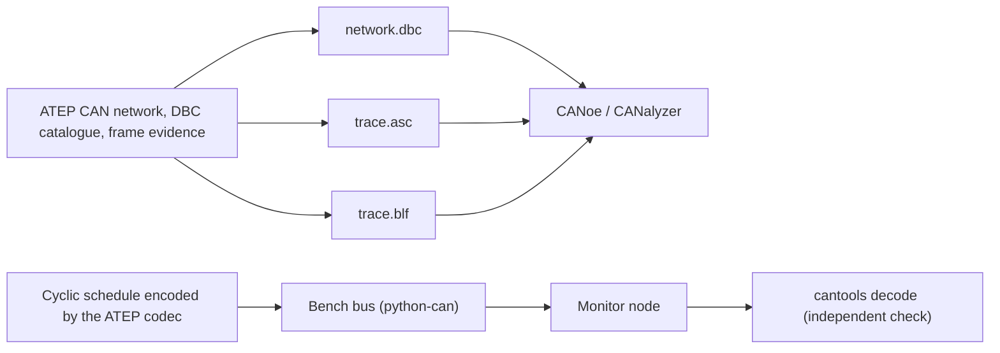

# Virtual Test Bench

Volume XI turns ATEP evidence into the artifacts a system-test engineer uses at a Vector CANoe
bench, and adds a python-can bus so the same test code can run against a virtual bus or a real
CAN interface. Requirements are in [requirements-volume-xi.md](requirements-volume-xi.md) and the
plan in [roadmap-volume-xi.md](roadmap-volume-xi.md).

## XI-1 Real CAN stack and Vector artifacts



### Exports API

Both endpoints need `can_networks:read`, change nothing and are rate limited like every API route.

- `GET /api/v1/vehicles/{vehicle_id}/can-networks/exports/dbc` returns the network as a DBC file
  (Windows-1252, CRLF). Without a DBC catalogue the file still lists every frame contract, with
  no signals.
- `GET /api/v1/vehicles/{vehicle_id}/can-networks/exports/trace?format=asc|blf&after_sequence=0&limit=10000`
  returns submitted frames in sequence order. Response headers: `X-ATEP-Frame-Count`,
  `X-ATEP-Last-Sequence` and `X-ATEP-Truncated`. To page, pass the last sequence as
  `after_sequence`.

### How ATEP maps to DBC

| ATEP | DBC |
|---|---|
| Frame contract `bms-status` | `BO_ 384 bms_status` (non-identifier characters become `_`) |
| Extended frame | Message ID with bit 31 set, `VFrameFormat` = `ExtendedCAN` |
| CAN FD frame | `VFrameFormat` = `StandardCAN_FD` or `ExtendedCAN_FD`; `CANFD_BRS` = 1 with bitrate switch |
| Producer and consumers | Sender node and signal receivers (`Vector__XXX` when none) |
| Intel / Motorola | `@1` / `@0`, start bit as stored by ATEP (MSB for Motorola) |
| No declared min/max | Range derived from the raw range, factor and offset |
| ECU without a record | Node name `ECU_<uuid hex>` |

Names that collide after conversion are rejected with `can_network_contract_invalid`.

### Timing in traces

- ATEP time is logical microseconds. ASC keeps it exactly; BLF stays within 1 µs.
- Measurement start is the network creation time in UTC, truncated to milliseconds.
- ASC and DBC output do not depend on the host clock, locale or time zone. BLF output is
  reproducible for identical input.

### Bench bus

`atep.bench.bus.BenchBusConfig` selects a python-can interface: `virtual` (default, no
hardware), `socketcan`, `vector`, `pcan` or `slcan`. Any other interface is rejected.
`replay_frames` sends frames at once (deterministic mode) or paced by their timestamps
(real-time mode).

### Demo

```bash
python tools/run_virtual_bench_demo.py --output out/virtual-bench
```

The demo sends one second of traffic for the reference CAN FD powertrain network (BMS and VCU,
three cyclic messages at 10, 20 and 100 ms), receives it on a second node and decodes every frame
with cantools. It writes `network.dbc`, `trace.asc`, `trace.blf` and `report.json`, and exits
with code 1 on any mismatch. Add `--realtime` to pace frames on the wall clock. With a real
interface, for example `--interface vector --channel 0`, the same traffic goes to hardware.

To inspect the result in CANoe or CANalyzer, add `network.dbc` as the database and open
`trace.asc` or `trace.blf` in offline mode.

### Limits

- The bench simulates the network and test logic. There is no electrical layer, no bit stuffing
  on the wire and no error frames from a physical bus.
- The trace export covers submitted frames. Arbitration batches and multi-bus campaigns are not
  exported yet.
- cantools is a development dependency. It checks ATEP output and is not used by the API.
