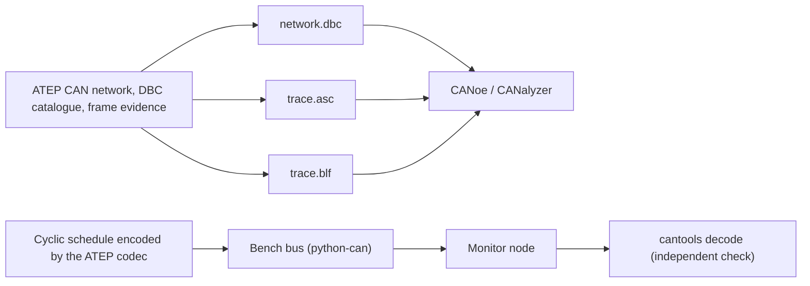
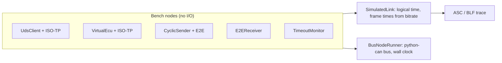
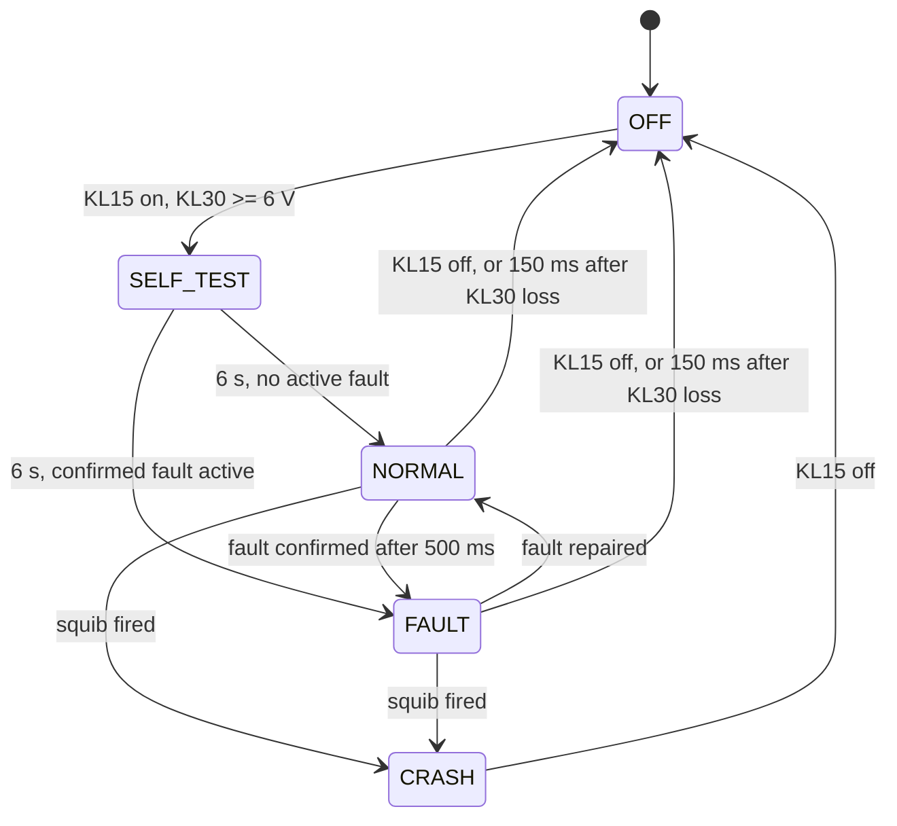
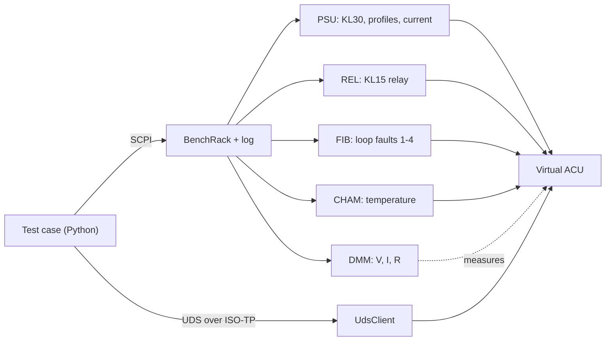
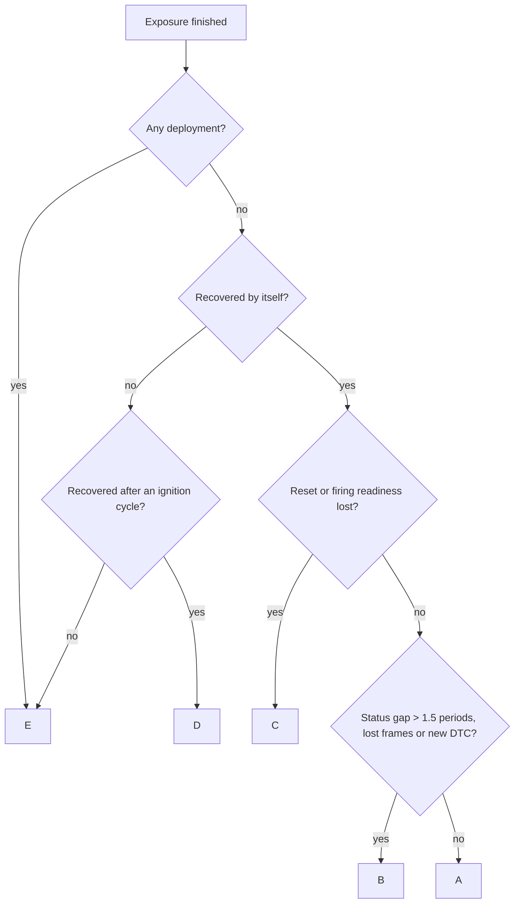
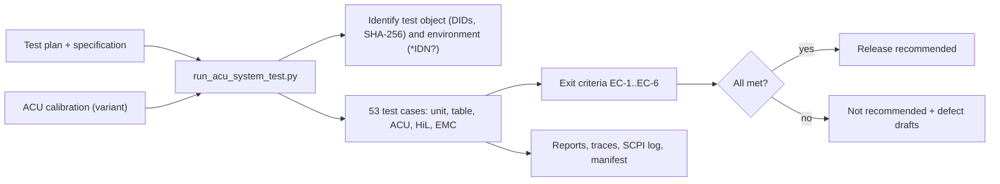

# Virtual Test Bench

Volume XI turns ATEP evidence into the artifacts a system-test engineer uses at a Vector CANoe
bench, and adds a python-can bus so the same test code can run against a virtual bus or a real
CAN interface. Requirements are in [requirements-volume-xi.md](requirements-volume-xi.md) and the
plan in [roadmap-volume-xi.md](roadmap-volume-xi.md).

## XI-1 Real CAN stack and Vector artifacts



### Exports API

Both endpoints need `can_networks:read`, change nothing and are rate limited like every API route.

- `GET /api/v1/vehicles/{vehicle_id}/can-networks/exports/dbc` returns the network as a DBC file
  (Windows-1252, CRLF). Without a DBC catalogue the file still lists every frame contract, with
  no signals.
- `GET /api/v1/vehicles/{vehicle_id}/can-networks/exports/trace?format=asc|blf&after_sequence=0&limit=10000`
  returns submitted frames in sequence order. Response headers: `X-ATEP-Frame-Count`,
  `X-ATEP-Last-Sequence` and `X-ATEP-Truncated`. To page, pass the last sequence as
  `after_sequence`.

### How ATEP maps to DBC

| ATEP | DBC |
|---|---|
| Frame contract `bms-status` | `BO_ 384 bms_status` (non-identifier characters become `_`) |
| Extended frame | Message ID with bit 31 set, `VFrameFormat` = `ExtendedCAN` |
| CAN FD frame | `VFrameFormat` = `StandardCAN_FD` or `ExtendedCAN_FD`; `CANFD_BRS` = 1 with bitrate switch |
| Producer and consumers | Sender node and signal receivers (`Vector__XXX` when none) |
| Intel / Motorola | `@1` / `@0`, start bit as stored by ATEP (MSB for Motorola) |
| No declared min/max | Range derived from the raw range, factor and offset |
| ECU without a record | Node name `ECU_<uuid hex>` |

Names that collide after conversion are rejected with `can_network_contract_invalid`.

### Timing in traces

- ATEP time is logical microseconds. ASC keeps it exactly; BLF stays within 1 µs.
- Measurement start is the network creation time in UTC, truncated to milliseconds.
- ASC and DBC output do not depend on the host clock, locale or time zone. BLF output is
  reproducible for identical input.

### Bench bus

`atep.bench.bus.BenchBusConfig` selects a python-can interface: `virtual` (default, no
hardware), `socketcan`, `vector`, `pcan` or `slcan`. Any other interface is rejected.
`replay_frames` sends frames at once (deterministic mode) or paced by their timestamps
(real-time mode).

### Demo

```bash
python tools/run_virtual_bench_demo.py --output out/virtual-bench
```

The demo sends one second of traffic for the reference CAN FD powertrain network (BMS and VCU,
three cyclic messages at 10, 20 and 100 ms), receives it on a second node and decodes every frame
with cantools. It writes `network.dbc`, `trace.asc`, `trace.blf` and `report.json`, and exits
with code 1 on any mismatch. Add `--realtime` to pace frames on the wall clock. With a real
interface, for example `--interface vector --channel 0`, the same traffic goes to hardware.

To inspect the result in CANoe or CANalyzer, add `network.dbc` as the database and open
`trace.asc` or `trace.blf` in offline mode.

## XI-2 ECU communication

XI-2 adds the protocols a system tester exercises on a bench: ISO-TP transport, UDS diagnostics
with response timing, cyclic message supervision and E2E protection. Every protocol is a
*sans-IO* node: it receives frames and the current logical time, and returns frames to send. It
never reads a clock or touches a bus, so the same node runs on two kinds of link.



### ISO-TP (`atep.bench.isotp`)

| Frame | First byte | Use |
|---|---|---|
| Single frame | `0L` (or `00 LL` on CAN FD) | Payload up to 7 bytes (62 on CAN FD with 64-byte frames) |
| First frame | `1L LL` | Starts a longer message, up to 4,095 bytes |
| Consecutive frame | `2N` | Next chunk; N counts 1..15 then wraps to 0 |
| Flow control | `3S BS ST` | Receiver says continue (0), wait (1) or overflow (2), with block size and STmin |

The sender waits up to N_Bs for each flow control and the receiver waits up to N_Cr for each
consecutive frame. Errors are reported as events, not exceptions.

### UDS tester and virtual ECU (`atep.bench.uds`, `atep.bench.virtual_ecu`)

- P2 (50 ms) runs from the end of the request transmission to the start of the response.
  A `7F <SID> 78` response-pending answer switches the wait to P2* (5 s).
- Bit 7 of the sub-function suppresses the positive response, only for services that have a
  sub-function. `22 F1 90` is not suppressed even though `0xF1` has bit 7 set.
- The virtual ECU supports session control, ECU reset, clear and read DTC (by status mask),
  read and write DID, security access and tester present. Non-default sessions fall back after
  S3 (5 s) without traffic. Three wrong keys lock security access for a delay. DIDs listed in
  `slow_dids` answer with response pending.

### Supervision and E2E (`atep.bench.supervision`, `atep.bench.e2e`, `atep.bench.cyclic`)

- `TimeoutMonitor` reports `waiting`, `ok` and `timeout` per message, including a message that
  never arrives, and debounces recovery.
- E2E stamps a 4-bit alive counter (0-14) and a CRC-8 SAE J1850 over a 16-bit data ID and the
  payload. The checker returns `initial`, `ok`, `ok_some_lost`, `repeated`, `wrong_sequence`,
  `wrong_crc` or `invalid_counter`.
- `CyclicSender` injects drop, corrupted-CRC, repeated-counter and skipped-counter faults on
  chosen cycles.

### Demo

```bash
python tools/run_ecu_communication_demo.py --output out/ecu-communication
```

The demo runs a 19-step diagnostic session (multi-frame transfers with flow control, security
access with a wrong key, response pending, suppressed response, DTCs, S3 timeout, reset) and an
E2E scenario with injected faults and timeout supervision. Each step has an expected result. It
writes `diagnostics.asc/.blf`, `e2e.asc/.blf` and `report.json`. Add `--bus virtual` to run the
diagnostic session on a python-can bus with the wall clock instead of the simulated link.

## XI-3 Virtual airbag control unit

The ACU (`atep.bench.airbag`) is the device under test of the bench. Bench inputs are methods
that take the current time, the way a HiL operator changes the supply, a squib load or a seat
mat: `set_power`, `set_loop_resistance`, `set_occupancy` and `inject_crash`. `AcuBench`
(`atep.bench.airbag_bench`) puts the ACU, a vehicle-status sender and a UDS tester on a simulated
bus. All thresholds are illustrative.



The warning lamp is on in SELF_TEST, FAULT and CRASH.

### Deployment decision

| Condition | Value |
|---|---|
| Delta-v window on the main sensor | 30 ms |
| Safing sensor confirmation | at least 3 g in the same window |
| Pretensioners | delta-v ≥ 6 km/h; driver if buckled, passenger if seat occupied |
| Airbags | delta-v ≥ 14 km/h; passenger only if seat occupied and airbag enabled |
| Arming delay after power-on | 200 ms |
| Energy reserve after supply loss | 150 ms, firing path only, no CAN |
| Crash event | firing allowed for 100 ms after the first squib, then latched |

A squib outside its 1.5-5.0 Ω window cannot fire and is recorded as failed.

### CAN and diagnostics

| ID | Message | Content |
|---|---|---|
| 0x0A0 | vehicle_status (VCU, 100 ms) | Vehicle speed; supervised, U0121 after 500 ms |
| 0x090 | acu_status (ACU, 100 ms) | E2E CRC and counter, system state, lamp, passenger airbag enabled, driver buckled, crash stored, active faults |
| 0x050 | acu_crash (ACU, on crash, 6 × 20 ms) | E2E CRC and counter, severity, fired and failed loop masks, delta-v |
| 0x7E2 / 0x7EA | UDS request / response | ISO-TP, served by the XI-2 virtual ECU with live DTCs and DIDs |

| DTC | Meaning |
|---|---|
| B1001-B1004 (0x13, 0x1A, 0x1B) | Driver airbag, passenger airbag, driver and passenger pretensioner loop: open, resistance low, resistance high |
| B1010 (0x16, 0x17) | Supply voltage low, high |
| U0121 | Lost communication with the vehicle status sender |
| B1050 | Crash recorded; survives a DTC clear |

### System-test campaign

```bash
python tools/run_airbag_bench_demo.py --output out/airbag-bench
```

Fifteen cases cover self-test, loop faults, supply range, lost communication, hammer-blow
misuse, low and severe crashes, the passenger airbag switch, energy reserve, an open loop during
a crash, the arming delay, DTC clearing and one-shot deployment. Every case lists its
requirements and compares each observation with an expected value. The campaign writes
`report.json`, `report.md`, `acu.dbc` and `acu-severe-crash.asc/.blf`. Load `acu.dbc` in CANoe or
CANalyzer to decode the trace.

## XI-4 Bench instruments

`HilBench` (`atep.bench.airbag_bench`) adds a rack of SCPI instruments to the ACU bench. The
supply output starts off and KL15 open, so a test powers the ACU the way an operator does.
Every command goes through `BenchRack.send`, which logs time, address, command and answer.



### SCPI commands

| Address | Commands |
|---|---|
| all | `*IDN?`, `*RST`, `*CLS`, `*OPC?`, `SYST:ERR?` |
| PSU | `VOLT <V>`, `VOLT?`, `OUTP ON\|OFF`, `OUTP?`, `MEAS:VOLT?`, `MEAS:CURR?`, `MEAS:CURR:PEAK?`, `SENS:CURR:PEAK:CLE`, `PROG:RUN <profile>`, `PROG:STAT?`, `PROG:CAT?` |
| REL | `ROUT:CLOS (@1)`, `ROUT:OPEN (@1)`, `ROUT:CLOS? (@1)`; channel 1 is KL15 |
| FIB | `ROUT:CLOS (@n)` (nominal 2.2 Ω), `ROUT:OPEN (@n)`, `ROUT:SHOR:GND (@n)`, `ROUT:SHOR:BATT (@n)`, `SOUR:RES <ohm>,(@n)`, `ROUT:STAT? (@n)`; channels 1-4 are driver airbag, passenger airbag, driver and passenger pretensioner |
| DMM | `MEAS:VOLT:DC?`, `MEAS:CURR:DC?`, `MEAS:RES? (@n)` |
| CHAM | `TEMP <°C>`, `TEMP?`, `TEMP:SETP?`, `TEMP:RATE <°C/min>`, `TEMP:RATE?` |

Long forms (`:VOLTage`, `MEASure:CURRent?`) and the optional `OUTPut:STATe` node are accepted.

### Voltage profiles

| Profile | Shape | Expected ACU behaviour |
|---|---|---|
| `momentary_drop` | 4.5 V for 100 ms | No reset: the 150 ms energy reserve bridges it |
| `dropout` | 0 V for 300 ms | Reset and new self-test |
| `starting_profile` | 4.5 V for 15 ms, 6.5 V for 1 s, recovery | No reset, undervoltage DTC not confirmed (2 s debounce) |
| `slow_decrease_increase` | 12 V to 0 V and back at 1 V/s | Off below 6 V, restart above, undervoltage DTC stored |
| `overvoltage` | 18 V for 3 s | Overvoltage DTC confirmed after 2 s, healed afterwards |

### HiL campaign

```bash
python tools/run_hil_bench_demo.py --output out/hil-bench
```

Fifteen cases cover rack identification, quiescent current, constant input power, every voltage
profile, loop shorts, the resistance window at its boundaries (1.4, 1.5, 5.0 and 5.1 Ω), loop
resistance measurement, harness drift over temperature, over-temperature, squib firing current
and SCPI error handling. The campaign writes `report.json`, `report.md` and `scpi-log.txt`.

## XI-5 Transients and EMC concepts

XI-5 shows how an EMC/transient test plan is written and judged. It is a behavioural model, not
an EMC measurement: levels are illustrative and the ACU reaction comes from its input-protection
model.

### Transient generator (TRG)

| Pulse | Shape (illustrative) | Coupling | ACU reaction |
|---|---|---|---|
| 1 | -100 V, 2 ms, every 0.5 s, 10x | Supply | Reverse-polarity diode blocks it: a 2 ms interruption bridged by the energy reserve; no CAN while on reserve |
| 2a | +50 V, 50 µs, every 0.5 s, 10x | Supply | Absorbed by the 1 ms input filter |
| 3a / 3b | 10 ms bursts every 100 ms, 10x | CAN | Each attempt in a burst is an error frame; frames are retransmitted after the burst |
| 5b | 35 V for 400 ms (load dump, Us 87 V suppressed) | Supply | TVS clamps to 33 V; above 30 V the firing path latches off until the next ignition cycle (B1070-17, lamp on) |

Commands: `PULS:CAT?`, `PULS:SEL <name>`, `PULS:LEV <V>`, `PULS:WIDT <s>`, `PULS:COUN <n>`,
`PULS:RUN`, `PULS:STAT?`. The width must stay shorter than the repetition period, so set
`PULS:COUN 1` before a long `PULS:WIDT`.

### CAN disturbance model

Inside a disturbance window every transmission attempt is destroyed and written to the trace as
an error frame (`ErrorFrame` in ASC). The controller retransmits automatically; after 32 errors
in a row it goes bus-off and waits 128 × 11 bit times (2.8 ms at 500 kbit/s) before trying again.
A disturbance therefore delays frames. Only a frame still unsent after 2 s is lost.

### Functional status classification

`atep.bench.emc.observe` watches the ACU from the start of an exposure until a recovery period
after it, optionally probing it mid-exposure, and classifies the result:



### EMC campaign

```bash
python tools/run_emc_bench_demo.py --output out/emc-bench
```

| Test | Exposure | Required class | Achieved |
|---|---|---|---|
| EMC-T01 | Pulse 1 | B | B (status gaps while on reserve) |
| EMC-T02 | Pulse 2a | A | A |
| EMC-T03 | Pulse 3a on CAN | A | A (frames delayed about 10 ms) |
| EMC-T04 | Pulse 3b on CAN | A | A |
| EMC-T05 | Load dump 5b | D | D (safe state until ignition cycle) |
| EMC-T06 | 800 ms CAN burst | B | B (U0121 pending, recovered) |
| EMC-T07 | 300 ms supply interruption | C | C (reset and new self-test) |

Every test also checks that the ACU did not deploy. Class D for the load dump is intended: an
airbag ECU must rather disable its firing path than risk an unintended deployment, and it
signals that state with the lamp and a DTC. The campaign writes `emc-test-plan.md`, the reports,
`acu.dbc` and `emc-pulse-3a.asc/.blf`, whose error frames show in CANoe.

## XI-6 vTESTstudio-style authoring

XI-6 lets a test engineer write bench tests the way they would in vTESTstudio and CANoe, and get
the reports and traceability an ALM tool expects.

### Event-driven test units (`atep.bench.testunit`)

```python
unit = TestModule("ACU event-driven test unit")


@unit.test_case(
    "TU-ACU-003",
    "Warning lamp reaction to an open squib loop",
    requirements=("BENCH-F-025", "BENCH-F-026"),
)
def lamp_reaction(t: TestContext) -> None:
    t.scpi("PSU", "OUTP ON")
    t.scpi("REL", "ROUT:CLOS (@1)")
    t.expect_signal("acu_status", "SystemState", low=2, high=2, timeout_ms=6_500)
    t.scpi("FIB", "ROUT:OPEN (@2)")
    t.expect_signal("acu_status", "WarningLamp", low=1, high=1, timeout_ms=800)
```

| CAPL / vTESTstudio | Bench test unit |
|---|---|
| `TestStep`, `TestStepPass`, `TestStepFail` | `step`, `check` (equality or `at_most` limit) |
| `TestWaitForTimeout` | `wait` |
| `TestWaitForMessage` | `wait_for_message` (returns decoded signals or `None`) |
| `TestWaitForSignalInRange` | `wait_for_signal`, `expect_signal` |
| `on message` / `on timer` | `on_message`, `on_timer` (handlers must not wait) |
| Diagnostic request with expected response | `expect_diag(request, response_prefix=… or nrc=…)` |

Each test case runs on a fresh `HilBench`. Verdicts follow the worst-wins rule
(error > fail > inconclusive > pass); a case without steps is inconclusive, and an exception
becomes an error step instead of stopping the module.

### Test tables (`atep.bench.testtable`)

Test tables are JSON files a test engineer can edit without Python. Each parameter set becomes
its own test case: `TT-ACU-001` below expands into `TT-ACU-001[1]` to `TT-ACU-001[5]`.

```json
{
  "id": "TT-ACU-001",
  "title": "Driver airbag loop at {ohm} ohm reports failure type {failure}",
  "requirements": ["BENCH-F-025", "BENCH-F-040"],
  "parameters": [{"ohm": 1.4, "failure": "1A"}, {"ohm": 1.5, "failure": "none"}],
  "steps": [
    {"do": "switch_on"},
    {"do": "scpi", "address": "FIB", "command": "SOUR:RES {ohm},(@1)"},
    {"do": "wait", "ms": 600},
    {"do": "check_dtc", "dtc": "B1001", "failure": "{failure}"}
  ]
}
```

Actions: `switch_on`, `ignition`, `scpi` (optional `expect`), `wait`, `expect_diag`, `check_dtc`,
`expect_signal`, `check_state`, `check_lamp`, `occupancy`, `crash`, `check_fired`. The shipped
table `tools/test_tables/acu_system_tests.json` holds 11 cases: the loop resistance boundaries,
the deployment matrix by occupancy, a diagnostic session and an ignition cycle.

### Reports and traceability (`atep.bench.reports`)

| File | Content |
|---|---|
| `test-report.xml` | CANoe-style report: test module, test cases with requirements, parameters and times, test steps with expected and actual |
| `junit.xml` | For CI: fail as `<failure>`, error as `<error>`, inconclusive as `<skipped>` |
| `report.html` | One page with verdict colours and the steps of every case that did not pass |
| `traceability.csv` | Requirement ID, test case ID, title, verdict, module; for ALM import |
| `coverage.md` | Each requirement of this volume: verified, failed, unit tests only or not covered |

Coverage reads the requirement tables of `requirements-volume-xi.md`. A requirement cited by a
passing system-level case is *verified*; one whose evidence column points only to `tests/` is
*unit tests only*. The first run found two real traceability gaps: BENCH-F-039 and BENCH-NF-015
named test cases as evidence that did not cite them. Both are fixed, and a test now fails if a
case cites an undefined requirement or a requirement is left uncovered.

### Consolidated run

```bash
python tools/run_test_units_demo.py --output out/test-units
```

Runs the event-driven test unit (5 cases), the JSON test table (11 cases) and the ACU, HiL and
EMC campaigns (37 cases), and writes every report above.

## XI-7 System test campaign

XI-7 delivers the ACU system test the way a system test engineer hands it over: a
[test plan](acu-system-test-plan.md), a [test specification](acu-system-test-specification.md),
one automated run and a test summary report with a release recommendation.

```bash
python tools/run_acu_system_test.py --output out/acu-system-test
python tools/run_acu_system_test.py --variant no-firing-inhibit --output out/defective
```



| Variant | Result |
|---|---|
| `baseline` | 53/53 passed, 6/6 exit criteria met, release recommended |
| `short-supply-debounce` | HIL-T06 fails (engine start confirms a DTC): not recommended |
| `no-firing-inhibit` | EMC-T05 fails, safety-related: not recommended |
| `high-airbag-threshold` | 10 safety-related cases fail, including the misuse case whose precondition no longer holds: not recommended |

The summary report lists the test object (software version and VIN read over UDS, calibration
and DBC fingerprints), the environment, results per module, each exit criterion with its detail,
and one defect draft per failing case. `evidence-manifest.json` holds the SHA-256 of every
delivered file.

## Limits

- The bench simulates the network and test logic. There is no electrical layer, no bit stuffing
  on the wire and no error frames from a physical bus.
- The trace export covers submitted frames. Arbitration batches and multi-bus campaigns are not
  exported yet.
- cantools is a development dependency. It checks ATEP output and is not used by the API.
